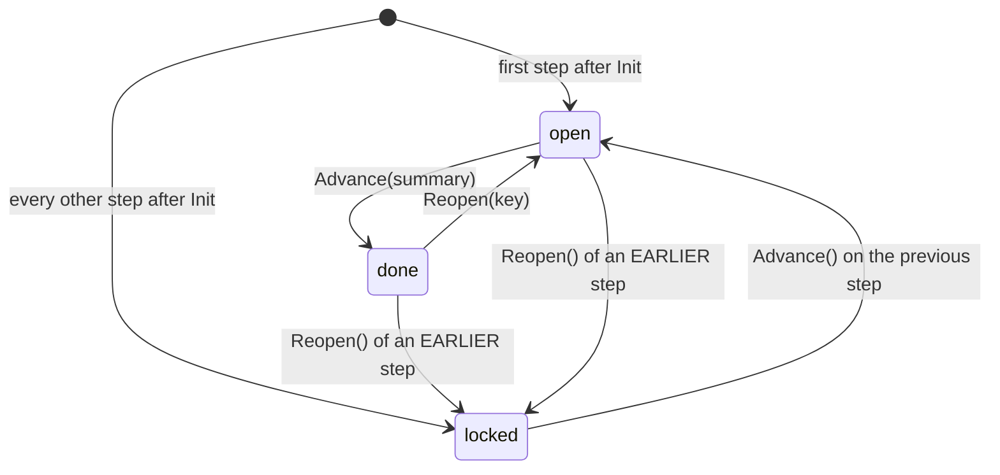
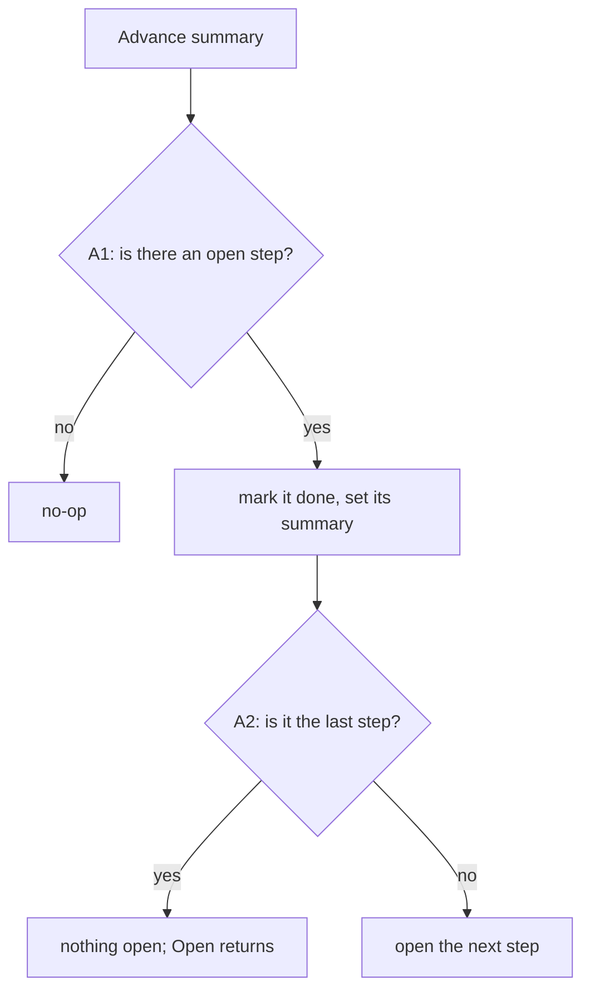
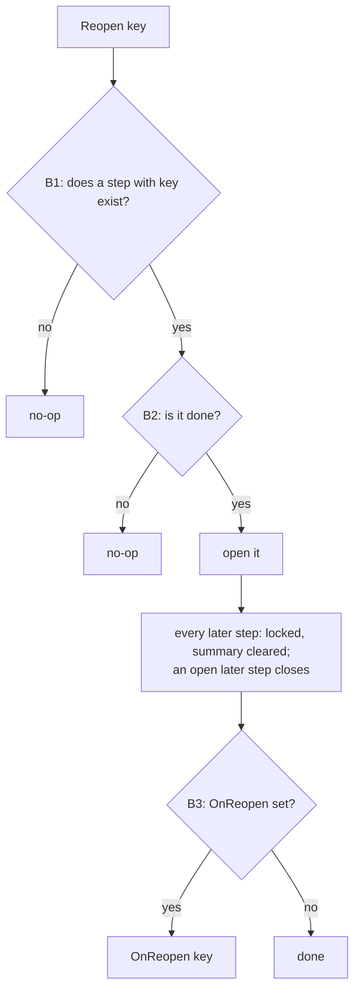
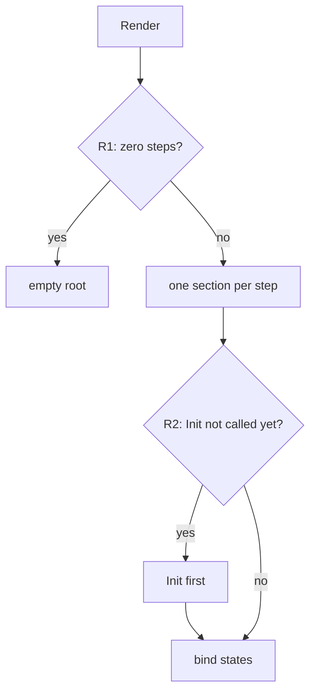
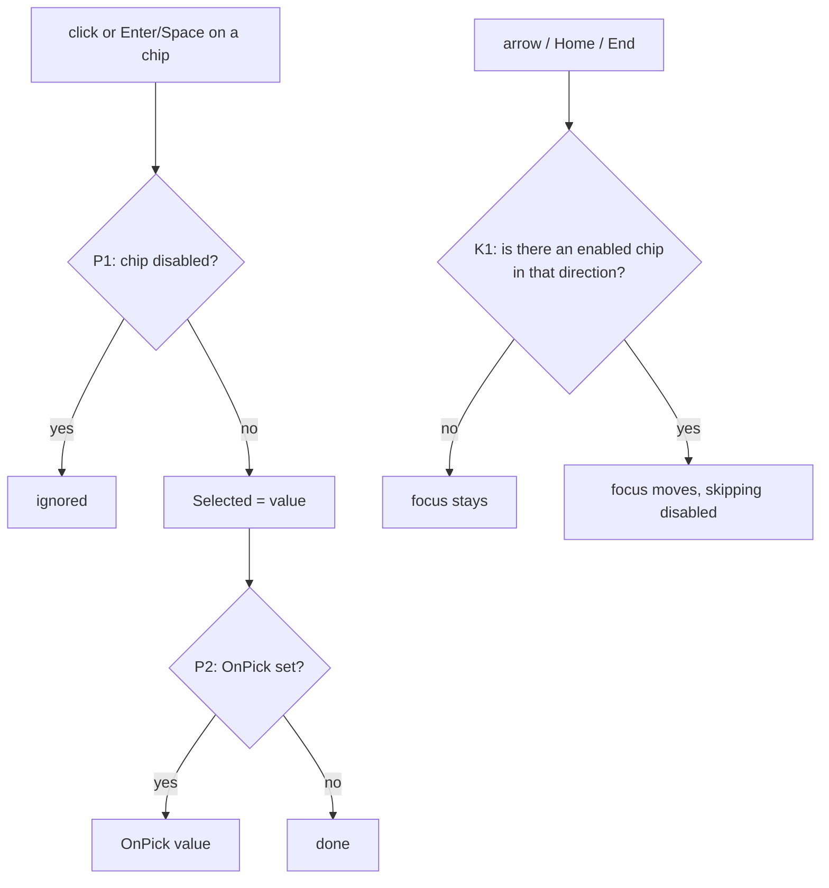
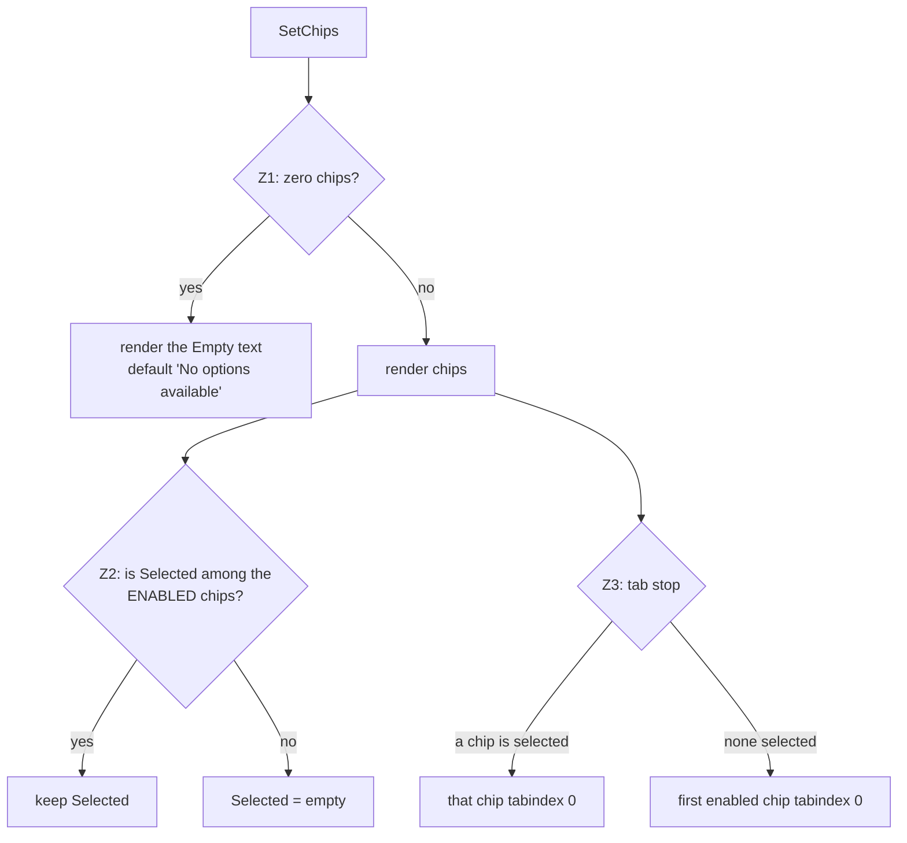

# `stepaccordion` and `chipgrid` — behaviour

Every diamond has an id. The traceability table in [`docs/PLAN.md`](../PLAN.md) §5 maps each
branch (`A1-yes`, `A1-no`, …) to the test that covers it. A branch without a test is a defect.

## 1. StepAccordion — step phases

## 2. StepAccordion — `Advance(summary)`

## 3. StepAccordion — `Reopen(key)`

## 4. StepAccordion — render

## 5. ChipGrid — pick and keyboard

## 6. ChipGrid — `SetChips(chips)`

